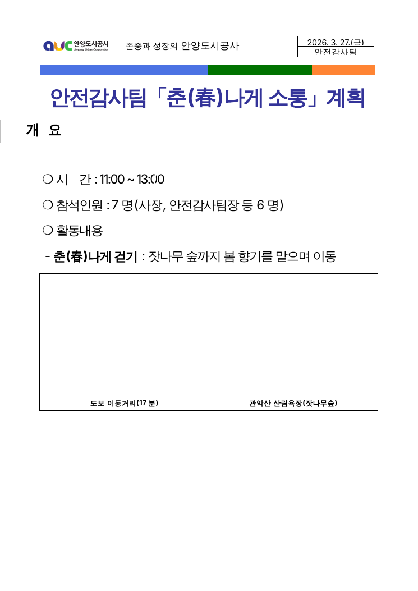
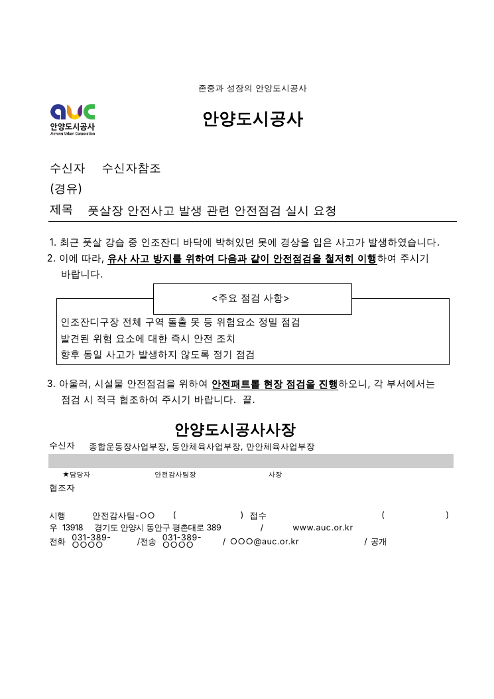
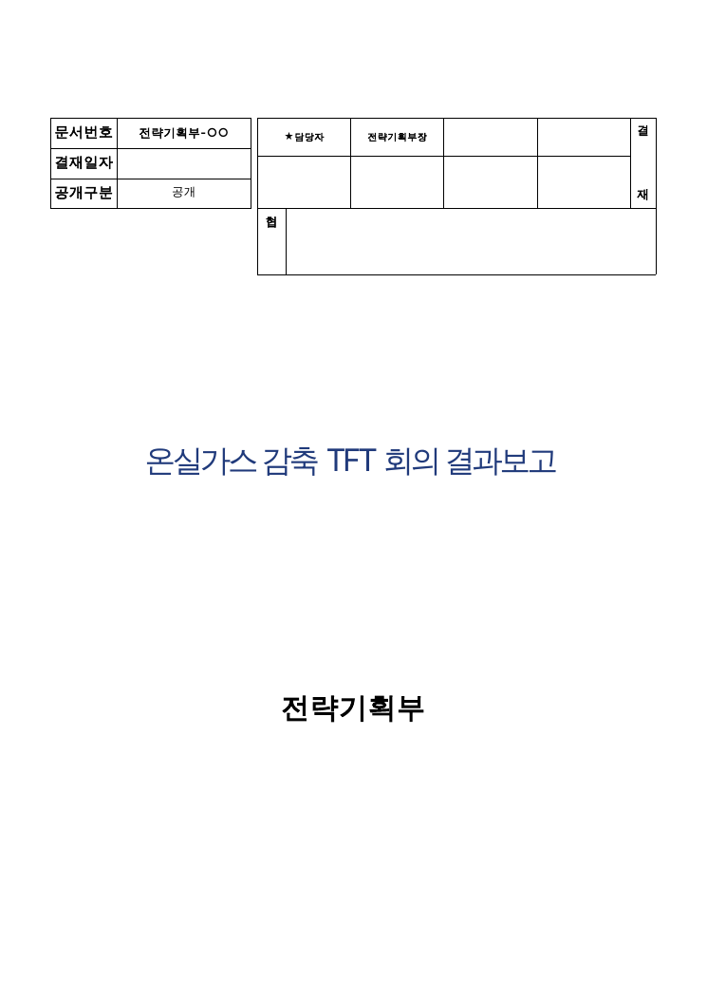
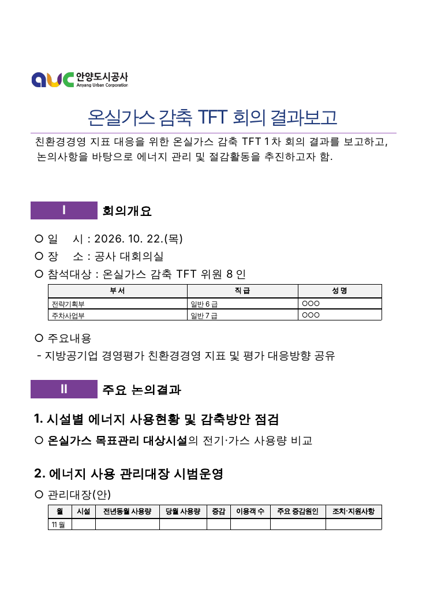
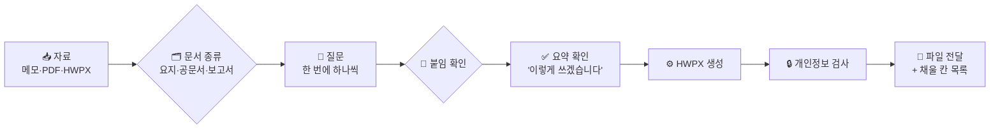

<div align="center">

# 📄 안양도시공사 문서작성 스킬

**메모 한 줄 → 질문 몇 개 → 공사 서식 그대로의 HWPX**

요지 · 공문서(시행문) · 내부 보고서를 대신 써 주는 Claude 스킬

<picture></picture>
<picture></picture>
<picture></picture>
<picture></picture>

[빠른 시작](#-빠른-시작) · [사용 예시](#-사용-예시) · [지원 문서](#-지원-문서) · [개인정보](#-개인정보-보호)

</div>

---

## ✨ 이런 일을 합니다

| | |
|---|---|
| 📥 **무엇이든 넣으세요** | 메모, PDF, HWPX, 회의록 — 있는 자료 그대로 |
| 🗂 **문서 종류부터 묻습니다** | 처음에 ① 요지 / ② 공문서 / ③ 보고서 중 무엇으로 만들지 확인 |
| 💬 **하나씩 물어봅니다** | 빠진 내용(수신, 일정, 붙임, 어조…)을 한 번에 하나씩 질문 |
| ✅ **쓰기 전에 확인합니다** | "이렇게 쓰겠습니다" 요약을 보여 주고 승인 후 생성 |
| 🏢 **공사 서식 그대로** | 실제 요지·기안문·보고서 서식을 틀로 써서 글꼴·표·결재란이 원본과 동일 |
| 🚫 **지어내지 않습니다** | 날짜·붙임·법령 근거·수치는 자료나 답변에 있는 것만 |
| 🔒 **개인정보를 다루지 않습니다** | 이름·전화·이메일은 묻지도 옮기지도 않고 자리표시로 |

<table>
<tr>
<td align="center" width="50%"></td>
<td align="center" width="50%"></td>
</tr>
<tr>
<td align="center"><sub><b>① 요지</b> · <code>samples/yoji_two_pages.hwpx</code></sub></td>
<td align="center"><sub><b>② 공문서</b> · <code>samples/gongmun_futsal.hwpx</code></sub></td>
</tr>
<tr>
<td align="center"></td>
<td align="center"></td>
</tr>
<tr>
<td align="center"><sub><b>③ 보고서 표지</b> · <code>samples/report_tft.hwpx</code></sub></td>
<td align="center"><sub><b>③ 보고서 본문</b> · <code>samples/report_tft.hwpx</code></sub></td>
</tr>
</table>

<div align="center"><sub>LibreOffice로 렌더링한 미리보기입니다. 한글에서는 글꼴·간격이 조금 다를 수 있고,<br>요지의 <code>개 요</code> 라벨 옆 장식(입체 아이콘·선)은 미리보기에서 빠져 있습니다(한글 파일에는 그대로 있음).</sub></div>

---

## 🚀 빠른 시작

### claude.ai (웹·앱)

1. [`dist/auc-docs.zip`](dist/auc-docs.zip) 을 내려받습니다.
2. **claude.ai → 설정 → 기능 → 스킬 → 스킬 업로드** 에서 ZIP을 선택합니다.
3. **코드 실행** 기능이 켜져 있는지 확인합니다.
4. 대화창에 요청합니다.

```
풋살장에서 강습 중에 못 때문에 회원이 다쳤어.
체육사업부들한테 안전점검 하라는 공문 써줘. 우리는 안전감사팀이야.
```

> **팀에서 함께 쓰기** — Team/Enterprise 플랜이면 관리자가 조직 스킬로 한 번만 올리면 됩니다.
> 개인 플랜이면 각자 ZIP을 올려 주세요.

### ChatGPT

1. [`dist/auc-docs.zip`](dist/auc-docs.zip) 을 내려받습니다.
2. ChatGPT 왼쪽 화면에서 **플러그인 → 스킬** 로 들어갑니다.
3. **추가** 버튼 → **컴퓨터에서 업로드** 를 눌러 ZIP을 선택합니다.
4. 대화창에 claude.ai와 똑같이 요청합니다.

---

## 💬 사용 예시



<details open>
<summary><b>대화 흐름 예시</b></summary>

> **👤 직원** 2026년 하반기 직원 교육 일정 안내 공문 써줘. 11월 12일, 13일 이틀이고 장소는 대회의실, 수신은 전 부서.
>
> **🤖 Claude** 어떤 문서로 만들까요? **① 요지**(한 장 요약) / **② 공문서**(시행문) / **③ 보고서**(표지+본문)
> 공문을 말씀하셨으니 ②로 하시려는 것 같은데 맞나요?
>
> **👤 직원** 응 공문
>
> **🤖 Claude** **다음 질문입니다. 어떤 교육인가요? 교육명과 하루 교육 시간을 알려 주세요.**
>
> **👤 직원** 청렴·직장 내 괴롭힘 예방교육, 14:00~16:00, 같은 교육 이틀 반복이라 하루만 골라 참석
>
> **🤖 Claude** *(발신 부서, 결재선, 어조를 차례로 질문)*
>
> **🤖 Claude** 만들기 전에 확인해 주세요. **이렇게 쓰겠습니다** — 제목 / 수신 / 본문 요지 / 강조 / **붙임: 없음** / 결재선 …
> 붙임으로 넣을 문서가 없고 위 내용이 맞으면 "좋아"라고 답해 주세요.
>
> **👤 직원** 좋아
>
> **🤖 Claude** 📄 `교육일정_안내.hwpx` — 한글에서 채울 칸: 담당자 이름·전화·이메일, 문서번호, 시행일자

</details>

**급할 때** — "질문하지 말고 바로 써줘"라고 하면 바로 만듭니다. 대신 모르는 날짜·부서는 `○○`로 비워 두고
**채워야 할 칸 목록**을 함께 드립니다.

---

## 📑 지원 문서

<table>
<tr>
<th width="33%">📝 요지</th>
<th width="33%">📨 공문서 (시행문)</th>
<th width="33%">📊 내부 보고서</th>
</tr>
<tr valign="top">
<td>

- 한 장 요약, 주제별로 여러 쪽
- 머리: 로고·표어·날짜·부서
- 색 띠 + 큰 제목
- `개  요` 라벨 (바꿀 수 있음)
- 항목 ` ❍` → `-` → `※`
- 표 (열 너비 자동)
- 사진 칸 2개 + 설명

</td>
<td>

- 표어·로고·기관명, 수신·경유·제목
- 본문 `1.` → `가.` → `1)` → `가)` 자동 번호
- 핵심 문구 **굵게+밑줄**
- `<주요 점검 사항>` 박스
- **붙임** `붙임  1. ○○ 1부.` 정렬
- `  끝.` 위치 자동 처리
- 발신명의, 수신자, 결재·협조란, 시행 정보

</td>
<td>

- 표지: 문서번호·결재일자·공개구분, 결재·협조란
- 목적 한 문장 (`~하고자 함.`)
- 대제목 `Ⅰ Ⅱ Ⅲ …` 자동
- 항목 체계 ` 1.` → `○` → `-` → `※`
- 표 (열 너비 자동), 사진대지 칸
- 향후계획 일정 `○ 내용 ······ 2026.11월`
- 개조식 문체 (`~공유`, `~추진`)

</td>
</tr>
</table>

---

## 🔒 개인정보 보호

| 항목 | 처리 |
|---|---|
| 사람 이름 | 묻지 않음 · 자료에 있어도 `○○○` |
| 전화·휴대폰 | 묻지 않음 · `031-389-○○○○` |
| 이메일 | 묻지 않음 · `○○○@auc.or.kr` |
| 참석자 표 | 부서·직급만, 성명은 `○○○` |
| 직위·부서명 | 개인정보 아님 → 그대로 사용 (★담당자, 안전감사팀장 …) |

생성된 파일은 `check_privacy.py`가 자동으로 검사합니다.
전화번호(괄호·국제번호·붙여쓰기 포함), 이메일, `담당자: 홍길동` 같은 표기, 표의 성명 열까지 확인합니다.

---

## 🗂 구성

```
skill/auc-docs/              ← claude.ai에 올리는 스킬 (dist/auc-docs.zip)
├── SKILL.md                 질문 절차 · 지어내기 금지 · 개인정보 규칙
├── reference/
│   ├── yoji.md              요지 작성 규칙 · 질문 목록 · JSON 예시
│   ├── gongmun.md           공문 작성 규칙 · 질문 목록 · JSON 예시
│   └── report.md            보고서 작성 규칙 · 질문 목록 · JSON 예시
├── templates/
│   ├── yoji.hwpx            요지 서식 (사진 제거)
│   ├── gongmun.hwpx         공문 서식 (개인정보 제거)
│   └── report.hwpx          보고서 서식 (개인정보·사진 제거)
└── scripts/
    ├── build_hwpx.py        JSON → HWPX
    ├── yoji.py              요지 생성
    ├── gongmun.py           공문 생성
    ├── report.py            보고서 생성
    ├── hwpx_io.py           HWPX 읽기·쓰기, 원형 문단 복제
    └── check_privacy.py     개인정보 검사

samples/                     생성 예시 HWPX
tests/                       단위 테스트 + 행동 시나리오
tools/                       서식 정리 · 렌더링 미리보기 (개발용)
docs/                        설계 · 구현 계획 · 테스트 기록
```

**동작 원리** — 실제 공사 문서에서 본문만 비운 서식을 두고, 그 안의 문단·표를 **원형(prototype)으로 복제해 글자만 바꿉니다.**
그래서 글꼴·문단 모양·표 테두리가 원본과 같고, 결재란 같은 칸은 서식에 붙은 이름(`결재제목`, `직위.1` …)으로 정확히 채웁니다.

---

<div align="center">
<sub>⚠️ 결과물은 반드시 한글에서 열어 확인한 뒤 기안하세요. 문서번호·시행일자는 기안 시스템에서 정해집니다.</sub>
</div>
